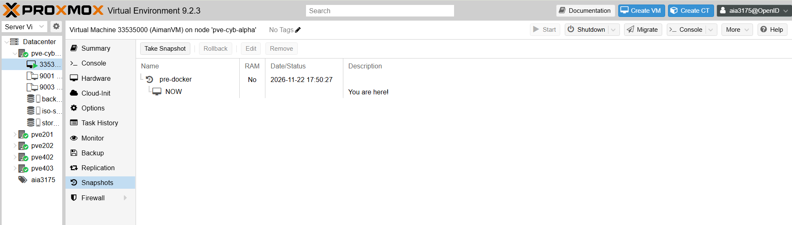
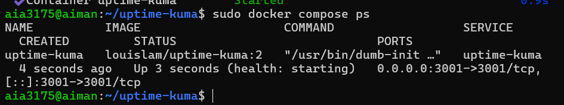
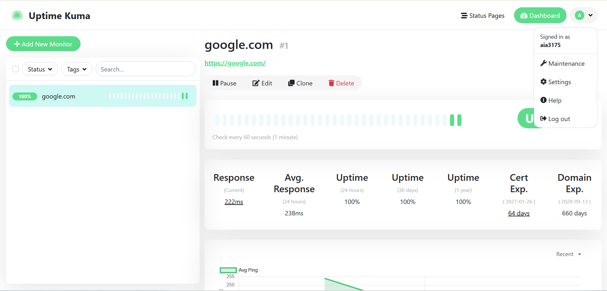
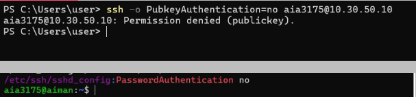
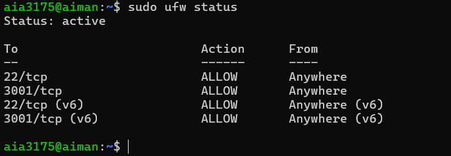
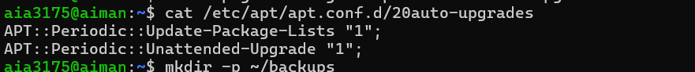
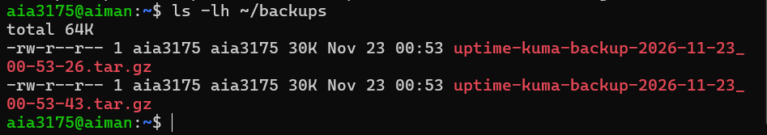
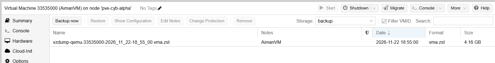
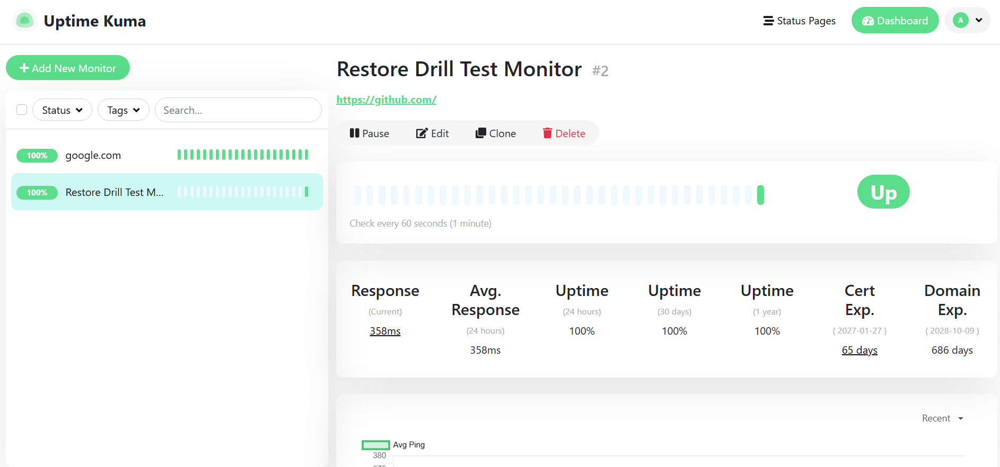
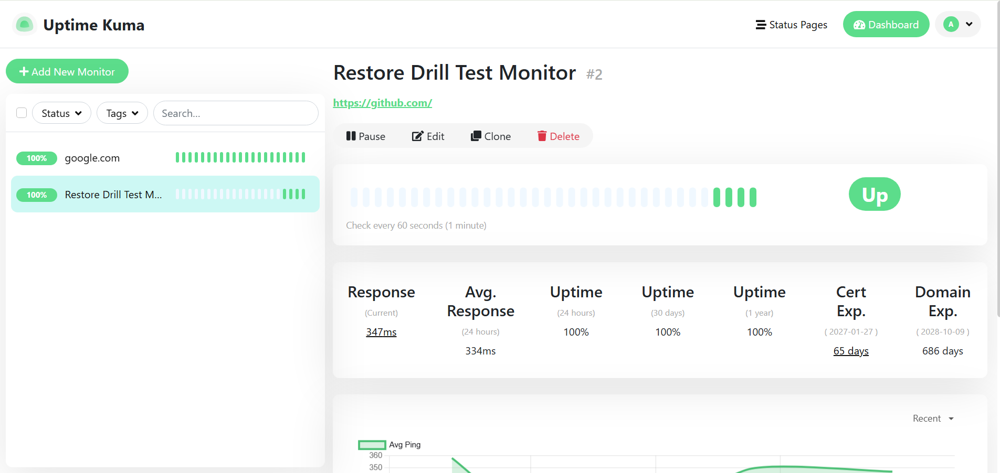

# Self-Hosting Uptime Kuma with Docker on Proxmox

## Overview & Environment
This guide shows how to install **Docker** and **Docker Compose** on an **Ubuntu 26.04.1 LTS** VM in **Proxmox VE**, deploy **Uptime Kuma v2**, secure the server, and set up automated backups and recovery.

---

## Step 1: Take a Baseline Snapshot
Before making any changes, create a snapshot in Proxmox so you can roll back if needed:
1. Select your VM in Proxmox and open the **Snapshots** tab.
2. Click **Take Snapshot**, name it `pre-docker`, and confirm.



---

## Step 2: Install Docker & Docker Compose

### 1. Check OS & Add Docker's GPG Key
```bash
# Check the Ubuntu version and codename
cat /etc/os-release

# Update packages and install curl and certificates
sudo apt update && sudo apt install -y ca-certificates curl

# Create the keyring folder and download Docker's GPG key
sudo install -m 0755 -d /etc/apt/keyrings
sudo curl -fsSL https://docker.com -o /etc/apt/keyrings/docker.asc
```

### 2. Add the Docker Repository & Install
```bash
# Add Docker's official Ubuntu repository
echo "deb [arch=$(dpkg --print-architecture) signed-by=/etc/apt/keyrings/docker.asc] https://download.docker.com $(. /etc/os-release && echo $VERSION_CODENAME) stable" | sudo tee /etc/apt/sources.list.d/docker.list

# Install Docker Engine and the Docker Compose plugin
sudo apt update && sudo apt install -y docker-ce docker-ce-cli containerd.io docker-buildx-plugin docker-compose-plugin
```

### 3. Enable at Boot & Test
```bash
# Enable Docker to start automatically on boot
sudo systemctl enable --now docker
systemctl is-enabled docker

# Verify Docker and Docker Compose work
sudo docker run --rm hello-world
docker compose version
```

---

## Step 3: Deploy Uptime Kuma

### 1. Create Project Folder & `compose.yaml`
```bash
# Create the project and persistent data folders
mkdir -p ~/uptime-kuma/data && cd ~/uptime-kuma
```

Save the following as `compose.yaml`:
```yaml
services:
  uptime-kuma:
    image: louislam/uptime-kuma:2
    container_name: uptime-kuma
    restart: unless-stopped
    ports:
      - "3001:3001"
    volumes:
      - ./data:/app/data
```

### 2. Start the Container & Finish Setup
```bash
# Start Uptime Kuma in the background
sudo docker compose up -d

# Check that the container is running
sudo docker compose ps
```



1. Open `http://<VM_IP_ADDRESS>:3001` in your browser.
2. Pick **SQLite** for the database, create your admin account (`aia3175`), and add a website monitor.



---

## Step 4: Secure the Server

### 1. Require SSH Keys (Disable Password Login)
**On your computer:**
```bash
# Generate an SSH key and copy it to the VM
ssh-keygen -t ed25519
ssh-copy-id aia3175@<VM_IP_ADDRESS>
```

**On the VM:**
```bash
# Turn off SSH password login and restart SSH
sudo sed -i 's/^#\?PasswordAuthentication.*/PasswordAuthentication no/' /etc/ssh/sshd_config
sudo sed -i 's/^PasswordAuthentication.*/PasswordAuthentication no/' /etc/ssh/sshd_config.d/*.conf 2>/dev/null || true
sudo systemctl restart ssh

# Confirm the setting is active
grep "^PasswordAuthentication" /etc/ssh/sshd_config /etc/ssh/sshd_config.d/*.conf 2>/dev/null
```



### 2. Enable the Firewall (UFW)
Allow only SSH (`22`) and Uptime Kuma (`3001`):
```bash
sudo ufw allow 22/tcp
sudo ufw allow 3001/tcp
sudo ufw enable
sudo ufw status
```



### 3. Enable Automatic Security Updates
```bash
sudo apt install -y unattended-upgrades
sudo dpkg-reconfigure -plow unattended-upgrades
cat /etc/apt/apt.conf.d/20auto-upgrades
```



---

## Step 5: Set Up Backups

### 1. Create the Backup Script (`~/backup_kuma.sh`)
This script stops Uptime Kuma so the database stays safe, compresses `./data` into `~/backups`, restarts the app, and keeps only the 7 newest backups:

```bash
mkdir -p ~/backups
```

```bash
#!/bin/bash
BACKUP_DIR="$HOME/backups"
APP_DIR="$HOME/uptime-kuma"
TIMESTAMP=$(date +"%Y-%m-%d_%H-%M-%S")
ARCHIVE_NAME="uptime-kuma-backup-$TIMESTAMP.tar.gz"

# Stop the container cleanly before backing up
cd "$APP_DIR" && sudo docker compose stop

# Archive the data folder and set file ownership
sudo tar -czf "$BACKUP_DIR/$ARCHIVE_NAME" -C "$APP_DIR" data
sudo chown $USER:$USER "$BACKUP_DIR/$ARCHIVE_NAME"

# Restart the container
sudo docker compose start

# Delete backups older than the 7 newest files
cd "$BACKUP_DIR" && ls -tp | grep -v '/$' | tail -n +8 | xargs -I {} rm -- {}

echo "Backup completed: $ARCHIVE_NAME"
```

### 2. Test the Script
```bash
chmod +x ~/backup_kuma.sh
~/backup_kuma.sh
sleep 5
~/backup_kuma.sh
ls -lh ~/backups
```



### 3. Take a Full VM Backup in Proxmox
In Proxmox, select your VM, open the **Backup** tab, and click **Backup now**.



---

## Step 6: Test Backup Recovery & Reboot

### 1. Capture a Test Monitor
Add a monitor named `Restore Drill Test Monitor` in Uptime Kuma, take a screenshot, and run the backup script:



```bash
~/backup_kuma.sh
```

### 2. Delete Data & Restore from Backup
```bash
# Stop Uptime Kuma and delete the data folder
cd ~/uptime-kuma
sudo docker compose down
sudo rm -rf ~/uptime-kuma/data

# Extract the newest backup archive and start the container again
NEWEST_BACKUP=\$(ls -t ~/backups/*.tar.gz | head -n 1)
sudo tar -xzf "\$NEWEST_BACKUP" -C ~/uptime-kuma
sudo docker compose up -d
```

Refresh `http://<VM_IP_ADDRESS>:3001` to confirm `Restore Drill Test Monitor` is back:



### 3. Reboot Survival Test
```bash
sudo reboot
```
After the VM restarts, refresh `http://<VM_IP_ADDRESS>:3001` to verify Uptime Kuma starts back up automatically.# sysadmin-docker
Lab 2 documentation
